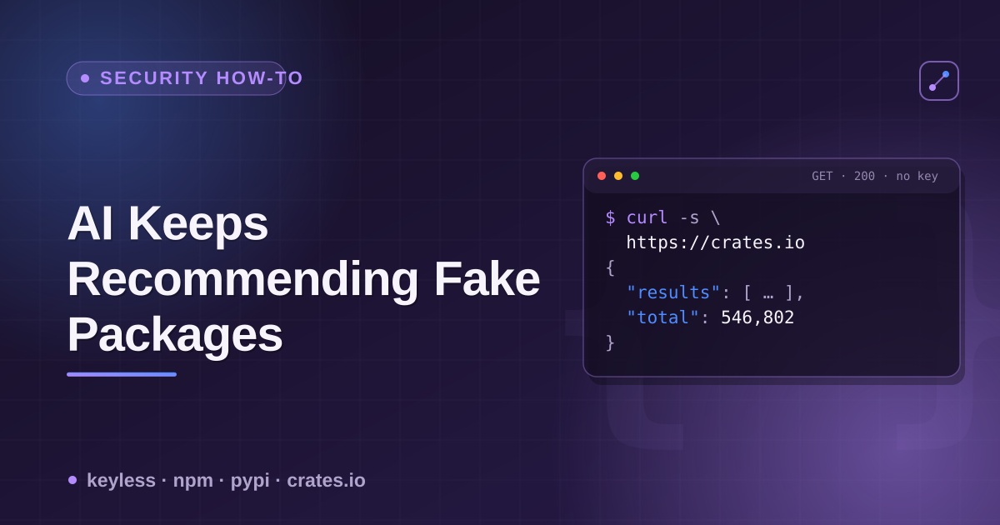

# package-hallucination-check



AI coding assistants invent plausible-sounding package names ("slopsquatting"
targets). Sometimes the name is real and safe, sometimes it's a confirmed
decoy, sometimes it's a confirmed attack that's been cleaned up, and
sometimes the exact name from a famous security write-up is just sitting
open on a registry, available to anyone. All four states are distinguishable
with a single keyless `curl`, per registry, before you run an install.

## The check, per registry

| Registry | Endpoint | What "doesn't exist" looks like | What "cleaned-up attack" looks like |
|---|---|---|---|
| npm | `GET https://registry.npmjs.org/{name}` | `{"error":"Not found"}` | `dist-tags.latest` version named like `0.0.1-security`, `maintainers: []`, description `"security holding package"` |
| PyPI | `GET https://pypi.org/pypi/{name}/json` | `{"message": "Not Found"}` | No equivalent — PyPI has no public "security hold" placeholder; a pulled name usually just goes back to `Not Found` |
| PyPI (fallback) | `GET https://pypi.org/simple/{name}/` | `404` | — |
| crates.io | `GET https://index.crates.io/{shard}/{name}` (sparse index) | `404` | No equivalent — crates.io has no documented hold mechanism either |

crates.io's shard path for a name of 4+ characters is `{first-2}/{next-2}/{name}`
(e.g. `serde` → `se/rd/serde`); 1-3 character names use shorter, fixed shard
prefixes (`1/{name}`, `2/{name}`, `3/{first-char}/{name}`).

## Three real, named cases checked live (2026-10-12)

```bash
# A confirmed, cleaned-up attack — npm
curl -s https://registry.npmjs.org/unused-imports | python3 -m json.tool
```
```json
{
  "dist-tags": {"latest": "0.0.1-security"},
  "maintainers": [],
  "versions": {
    "0.0.1-security": {"description": "security holding package"}
  },
  "time": {
    "1.0.0": "2025-03-17T10:12:34.110Z",
    "9.9.0": "2025-09-15T15:04:05.861Z",
    "0.0.1-security": "2025-10-27T06:10:25.273Z"
  }
}
```
Hallucinated instead of `eslint-plugin-unused-imports`, weaponized, then
held by npm. Note the `versions{}` object only carries the holding entry —
the real payloads are gone — but `time{}` still has timestamps for the
erased versions, giving you the actual window the attack was live: ~7 months
(March–October 2025) before the hold.

```bash
# A deliberate, defensive decoy — npm
curl -s https://registry.npmjs.org/react-codeshift | python3 -m json.tool
```
```json
{
  "maintainers": [{"name": "debugducky", "email": "debugducky@ceriksen.com"}],
  "versions": {
    "1.0.0": {
      "description": "Placeholder to prevent dependency confusion",
      "homepage": "https://intel.aikido.dev"
    }
  }
}
```
Registered January 2026 by a named security researcher (Aikido Security)
after the hallucinated name was observed spreading through 237 forked repos.
Not malicious — a parked name, on purpose.

```bash
# The name from the ORIGINAL 2023/2024 slopsquatting proof-of-concept — PyPI
curl -s https://pypi.org/pypi/huggingface-cli/json
# {"message": "Not Found"}
curl -s -o /dev/null -w "%{http_code}\n" https://pypi.org/simple/huggingface-cli/
# 404
curl -s https://pypi.org/pypi/huggingface_cli/json
# {"message": "Not Found"}   (underscore variant — also unclaimed)
```
Checked three ways (JSON API, PEP 503 Simple Index, underscore normalization)
to rule out a lookup miss. All three agree: the single most publicized
hallucinated-package name in the field is currently unclaimed on PyPI.

## Script it

```bash
#!/usr/bin/env bash
# usage: ./check-package.sh <name>
name="$1"
echo "npm:"
curl -s "https://registry.npmjs.org/$name" | python3 -c "
import json,sys
try:
    d=json.load(sys.stdin)
    if 'error' in d: print('  not found'); exit()
    v=d['dist-tags']['latest']
    print(f'  latest={v} maintainers={len(d.get(\"maintainers\",[]))}')
    if 'security' in v or not d.get('maintainers'):
        print('  ⚠️  looks like a security-holding placeholder')
except Exception as e:
    print('  error:', e)
"
echo "pypi:"
code=$(curl -s -o /dev/null -w "%{http_code}" "https://pypi.org/pypi/$name/json")
[ "$code" = "200" ] && echo "  exists" || echo "  not found ($code)"
```

## Why this matters more than a generic "does the package exist" check

A plain existence check tells you if `pip install` or `npm install` will
succeed. It doesn't tell you *why* a name resolves the way it does — a real,
healthy package; a name nobody's claimed yet (the dangerous state, if an AI
just told you to install it); a confirmed decoy; or a confirmed, cleaned-up
attack. npm's `maintainers: []` + `security holding` description is the one
machine-readable signal across these three registries that distinguishes
"cleaned up" from "never existed" — worth checking for before you treat a
200 response as "safe."

---

Built on top of
[`package-registry-scraper`](https://apify.com/ponderable_hydrometer/package-registry-scraper)
on Apify (keyless npm/PyPI/crates.io lookups as a dataset). Longer write-up
with the backstory: [dev.to article](https://dev.to/ronin13/ai-keeps-recommending-fake-packages-i-checked-which-ones-are-still-sitting-open).
